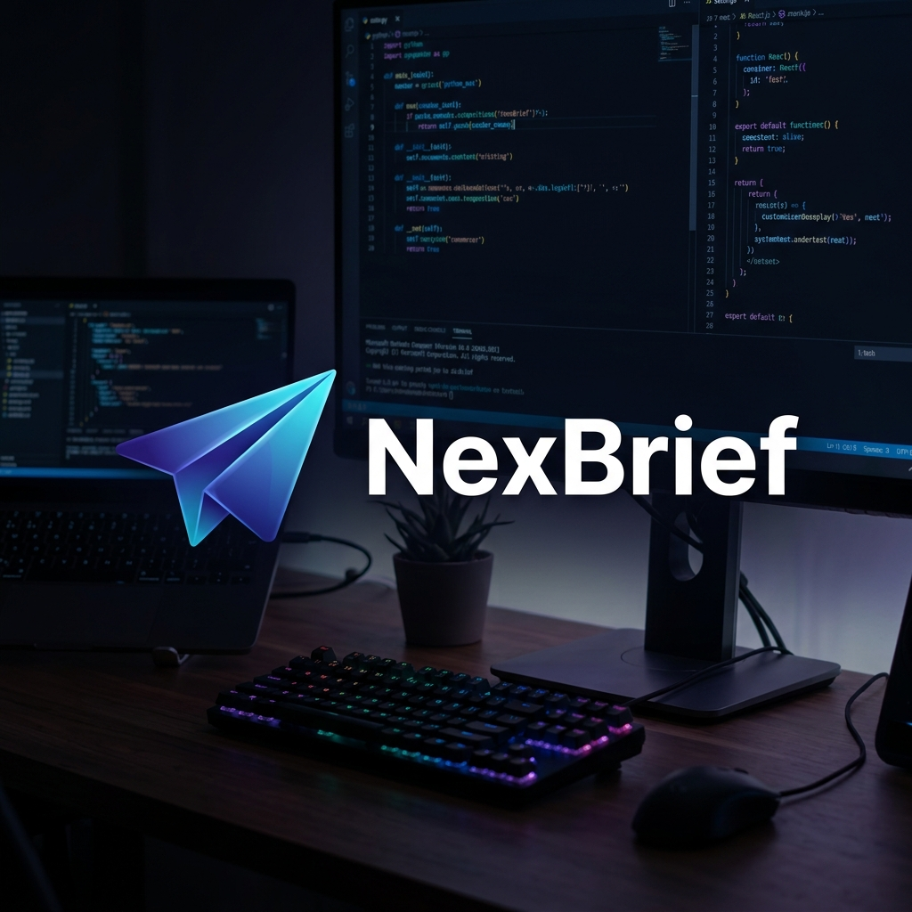

<div align="center">
  
  <br /><br />
  
  <h1>NexBrief — Daily IT &amp; Tech Intelligence Platform</h1>
  <p>
    <strong>India's first dedicated daily IT intelligence newsletter — 50% IT, Jobs &amp; AI, 30% Education &amp; Research, 20% World News.<br />
    Enriched with AI <em>"Why This Matters"</em> summaries &amp; delivered every morning at 7:00 AM IST.</strong>
  </p>

  <p>
    <a href="https://nexbrief-news.onrender.com" target="_blank">
      
    </a>
    <a href="https://nexbrief-news.onrender.com/archive" target="_blank">
      
    </a>
    
    
    
  </p>

  <p>
    📖 <a href="https://dev.to/mdrounaqali/how-i-built-nexbrief-an-automated-daily-it-newsletter-platform-for-engineering-students-3b57" target="_blank"><strong>Read the Architecture Deep Dive on Dev.to</strong></a>
    &nbsp;·&nbsp;
    🌐 <a href="https://nexbrief-news.onrender.com" target="_blank"><strong>nexbrief-news.onrender.com</strong></a>
    &nbsp;·&nbsp;
    👨‍💻 <a href="https://md-rounaq-ali.netlify.app/" target="_blank"><strong>Md Rounaq Ali Portfolio</strong></a>
  </p>
</div>

---

## 🎯 Why NexBrief?

Engineering students, freshers, and software developers in India lose 30–45 minutes every day sifting through noisy social feeds, generic portals, and irrelevant entertainment clicks just to track hiring drives, AI releases, and exam alerts.

**NexBrief** automates the entire signal-to-noise pipeline and delivers a structured, 2-to-5-minute morning briefing across **Email, Interactive Dashboard, Web Push Notifications, and an Installable PWA App** at **7:00 AM IST**.

---

## ✨ Platform Capabilities

### 📰 Student-Focused, India-First News Engine
- **60% India / 40% Global Ratio:** Every section prioritizes Indian IT hubs, campuses, startups, and hiring drives while preserving high-signal global engineering updates.
- **Strict Relevance Filtering:** Automatically strips out off-topic noise (gaming leaks, entertainment, celebrity, sports tabloid stories).
- **Dynamic Section Balancing:**
  - 🔴 **50% IT, Jobs & AI (10–20 stories):** Ranked Jobs & Hiring (TCS, Infosys, Wipro, HCL, GCCs, Internships) → AI & LLMs → Frameworks & Dev Tools → Cybersecurity → Cloud.
  - 📚 **30% Education & Research (6–12 stories):** GATE, AICTE, UGC, IIT/NIT/BITS placements, hackathons, scholarships, ISRO & NASA R&D.
  - 🌐 **20% World Headlines (4–8 stories):** Startup funding, Digital India fintech, tech regulation & global markets.
- **3-Day Deduplication:** Cross-checks past sent digests so subscribers never receive repeat headlines.

### 🤖 AI "Why This Matters" Insights
- Uses **Google Gemini (`gemini-2.5-flash` batched JSON generation)** with an automatic **domain-aware intelligence fallback** to attach a 1-line actionable takeaway to every article (e.g., hiring eligibility impact, interview talking points, or developer stack relevance).

### 🗞️ SEO-Indexed Public Digest Archive (`/archive`)
- Server-rendered public pages at `/archive` and `/archive/YYYY-MM-DD` with full Open Graph tags, `NewsArticle` / `CollectionPage` JSON-LD structured data, dynamic XML sitemap generation (`/sitemap.xml`), and prev/next edition navigation.

### ⏰ Live 7:00 AM IST Countdown Timer
- Timezone-independent client countdown (`HH:MM:SS`) to the next **7:00 AM IST** edition visible across the Homepage, Dashboard, and Public Archive.

### 🔗 One-Click Social & Peer Sharing
- Direct WhatsApp, LinkedIn, X (Twitter), and Copy-Link sharing controls embedded on every article card, reader modal, and archive story.

### 🔔 Browser Web Push Notifications (7 AM IST)
- Powered by **VAPID Web Push (`web-push`)** with a persistent MongoDB VAPID key store fallback — alerts opted-in students every morning even when the browser tab is closed, plus an Admin Test Push control.

### 📱 Installable Progressive Web App (PWA)
- Complete with [`manifest.json`](public/manifest.json), true 192×192 & 512×512 app icons, Service Worker (`public/sw.js`) shell caching, and native install prompt support on Android, iOS, and Desktop browsers.

### 📧 Email Open Tracking & Admin Analytics
- Port-443 HTTPS delivery via **Brevo Transactional API** (bypassing cloud SMTP port blocks).
- Clean 1×1 transparent tracking pixel (`/api/track/open`) recording unique opens & open rates per edition inside the **Admin Analytics Dashboard**.
- Dual-OTP email verification (signup & password reset) + automated Brevo blocklist unblocking on re-subscribe.

---

## 🛠️ Tech Stack

| Layer | Technology | Purpose |
| :--- | :--- | :--- |
| **Backend** | Node.js (v18+), Express.js | REST API, SSR SEO archive, tracking, push & cron |
| **Database** | MongoDB Atlas + Mongoose 8 | Users, Pending OTPs, Digests, Push Subscriptions, Config |
| **AI Enrichment** | Google Gemini API + Smart Fallback | Batched 1-line *"Why This Matters"* takeaways |
| **Email Engine** | Brevo Transactional HTTPS API | High-deliverability Port 443 HTML emails + Open Pixel |
| **Push Alerts** | `web-push` (VAPID) + Service Worker | Morning digest browser push notifications |
| **Frontend & PWA** | Vanilla HTML5, CSS3, ES6 JS, PWA | Responsive dark glassmorphism, search, installable app |
| **Scheduling** | `node-cron` + `cron-job.org` | Reliable daily 7:00 AM IST execution & warm keep-alive |

---

## 📁 Project Structure

```text
nexbrief/
├── server/
│   ├── index.js                   # Express server, dynamic /sitemap.xml, SPA & archive routes
│   ├── config/db.js               # MongoDB connection setup
│   ├── jobs/dailyDigest.js        # 7 AM IST digest orchestrator (fetch → AI → email → push)
│   ├── middleware/
│   │   ├── auth.js                # JWT route protection middleware
│   │   └── admin.js               # Admin-only authorization guard
│   ├── models/
│   │   ├── Digest.js              # Digest articles, AI insights, open-tracking & push metrics
│   │   ├── User.js                # Subscriber profile, hashed auth & OTP state
│   │   ├── PendingUser.js         # TTL-indexed 15-min pending signup OTP records
│   │   ├── PushSubscription.js    # Browser Web Push VAPID endpoints
│   │   └── AppConfig.js           # Persistent runtime key storage (auto VAPID keys)
│   ├── routes/
│   │   ├── archive.js             # SSR SEO pages (/archive, /archive/:date)
│   │   ├── auth.js                # Signup OTP, Login, Forgot Password, Subscription toggle
│   │   ├── news.js                # Homepage preview, Today's digest, 7-day history
│   │   ├── newsletter.js          # Secure cron/manual trigger & admin test email
│   │   ├── push.js                # VAPID public key, push subscribe/unsubscribe & test push
│   │   ├── track.js               # 1×1 transparent GIF email open tracking endpoint
│   │   └── admin.js               # Subscriber management, open rates & push analytics
│   ├── services/
│   │   ├── newsService.js         # India-first (60/40) NewsAPI queries & relevance filter
│   │   ├── aiService.js           # Gemini batched "Why This Matters" + heuristic fallback
│   │   ├── emailService.js        # Brevo HTTP API sender + 4 responsive dark-theme templates
│   │   └── pushService.js         # VAPID Web Push broadcaster & expired endpoint cleanup
│   └── utils/dateIST.js           # Timezone-safe IST (UTC+5:30) date helpers
├── public/
│   ├── index.html                 # SEO-optimized landing page, countdown & topic search
│   ├── dashboard.html             # Subscriber digest reader with AI summaries & social share
│   ├── admin.html                 # Admin overview, open-rate stats, subscriber & push tools
│   ├── manifest.json              # PWA Web App Manifest
│   ├── sw.js                      # Service Worker (PWA offline shell + Push listener)
│   ├── robots.txt                 # Search engine crawl directives
│   ├── css/                       # style.css, dashboard.css, admin.css
│   ├── js/                        # pwa.js, app.js, dashboard.js, admin.js
│   └── images/                    # SVG logo, true PNG PWA icons (192/512/180/96/64) & banners
├── .env.example                   # Environment template
└── package.json
```

---

## ⚙️ Local Setup

### 1. Prerequisites
- **Node.js** `>= 18.0.0`
- **MongoDB Atlas** cluster URI
- **NewsAPI Key** (`newsapi.org`)
- **Brevo API Key** (`v3` transactional key)
- *(Optional)* **Google Gemini API Key** (`aistudio.google.com`) for LLM-generated *"Why This Matters"* takeaways

### 2. Install & Configure
```bash
git clone https://github.com/md-rounaq-ali/nexbrief-daily-it-intelligence-platform.git
cd nexbrief-daily-it-intelligence-platform
npm install
```

Copy `.env.example` to `.env` and fill in your credentials (`MONGODB_URI`, `JWT_SECRET`, `NEWS_API_KEY`, `BREVO_API_KEY`, `FROM_EMAIL`, `APP_URL`, and optional `GEMINI_API_KEY`).

### 3. Run Development or Production Server
```bash
# Development (auto-reload with nodemon)
npm run dev

# Production
npm start
```
Open `http://localhost:3000`.

---

## ⏰ Daily Automation (Render + cron-job.org)

| Trigger | Schedule | Endpoint | Notes |
| :--- | :--- | :--- | :--- |
| **Keep-Alive Ping** | Every 10–14 min | `GET /api/health` | Prevents Render free-tier sleep |
| **Daily Digest** | `07:00 AM IST` (`Asia/Kolkata`) | `POST /api/newsletter/trigger` | JSON body: `{"secretKey": "<JWT_SECRET>"}` |

---

## 👨‍💻 Author & License

Built with care for India's engineering community by **[Md Rounaq Ali](https://md-rounaq-ali.netlify.app/)** (B.Tech CSE, NNRESGI Hyderabad).  
🔎 Search Creator on Google: **[md rounaq ali ↗](https://www.google.com/search?q=md+rounaq+ali)**

Licensed under the **MIT License**.
